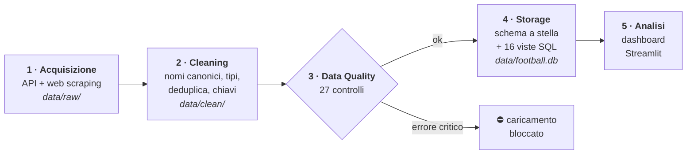

# ⚽ Serie A Data Hub

**Una pipeline di dati completa, dalla raccolta alla dashboard, sulle ultime 4 stagioni di Serie A.**

I dati arrivano da 7 fonti gratuite (API e web scraping). La pipeline li uniforma, li verifica con 27 controlli
di Data Quality, li salva in un data warehouse a stella e li analizza in una dashboard Streamlit interattiva.


<details>
<summary>🇬🇧 <b>English summary</b></summary>

End-to-end data engineering project on the last four completed Serie A seasons. It **acquires** data from
7 free sources (REST APIs, HTML scraping, and dynamic scraping with Selenium), **cleans and integrates** them
(canonical team names via alias dictionary + fuzzy matching, deterministic match keys, deduplication),
runs **27 data quality checks** across 5 dimensions with a blocking quality gate, **loads** a star-schema
warehouse (SQLite or PostgreSQL) in a single transaction with 16 analytical SQL views, and presents the
results in a **Streamlit dashboard**: standings, goal timing, market value vs. performance, betting-odds
calibration and expected points, xG, Elo, referee stats and data quality monitoring.
One CLI command runs everything: `python main.py run`. Code and docs are in Italian.
</details>

---

## Indice

- [Cosa fa, in 30 secondi](#cosa-fa-in-30-secondi)
- [Prova subito](#prova-subito)
- [Cosa si scopre dai dati](#cosa-si-scopre-dai-dati)
- [Come funziona](#come-funziona)
- [Fonti dati](#fonti-dati)
- [Competenze dimostrate](#competenze-dimostrate)
- [Struttura del repository](#struttura-del-repository)
- [Documentazione](#documentazione)

---

## Cosa fa, in 30 secondi

| | |
|---|---|
| **Domanda** | Che cosa determina il successo di una squadra di Serie A? Il budget, il fattore campo, i secondi tempi? E i bookmaker sanno prevederlo? |
| **Dati** | 1.521 partite, 3.745 gol con minuto e marcatore, 1.640 giocatori con ruolo, età e valore di mercato, 6.081 quote, xG e statistiche di gioco per ogni partita |
| **Periodo** | Le ultime 4 stagioni **concluse** (oggi 2022/23 → 2025/26). La finestra avanza da sola ogni 1° luglio |
| **Risultato** | Un database a stella interrogabile in SQL e una dashboard Streamlit con 7 pagine di analisi |
| **Un solo comando** | `python main.py run`: scarica ciò che manca, pulisce, controlla la qualità, carica |

## Prova subito

Il repository contiene già i dati grezzi: **non servono token né connessione** per vedere la dashboard.

```bash
git clone https://github.com/Tommasobru/data-management-project.git
cd data-management-project
python -m venv .venv && source .venv/bin/activate      # Windows: .venv\Scripts\activate
pip install -r requirements.txt

streamlit run app/Home.py      # apre http://localhost:8501 e costruisce il database al primo avvio
```

Per scaricare dati aggiornati dalle fonti, aggiungi i token gratuiti (facoltativi) e lancia la pipeline:

```bash
cp .env.example .env           # inserisci FOOTBALL_DATA_TOKEN e API_FOOTBALL_KEY
python main.py run             # acquisizione → cleaning → data quality → storage
```

Tutti i comandi sono nella [guida alla configurazione](docs/configurazione.md#comandi).

## Cosa si scopre dai dati

Alcuni risultati, tutti visibili nella dashboard:

| | Risultato | Pagina |
|---|---|---|
| 💰 | **Il valore della rosa spiega l'83% della classifica** (R² = 0,83). Ogni volta che il valore raddoppia, una squadra fa in media **17 punti in più** | Valore di mercato |
| 🎲 | **Le quote dei bookmaker sono ben calibrate**: un evento quotato al 30% accade circa il 30% delle volte. Il favorito vince il 54% delle partite | Quote e pronostici |
| 📉 | **Nessuna strategia semplice batte il banco**. Puntare sempre sulla sfavorita perde il 21%, sempre sul favorito circa l'1% (il margine del bookmaker è del 4,7%) | Quote e pronostici |
| 🏟️ | **Il fattore campo si sta riducendo**: le vittorie in casa scendono dal 42% (2022/23) al 39% (2025/26), quelle in trasferta salgono dal 31% al 35% | Classifiche |
| 🚀 | **Napoli 2022/23 e Inter 2023/24** hanno fatto circa **15 punti in più** di quanto prevedevano le quote a inizio partita | Quote e pronostici |
| ⏱️ | **Juventus è la squadra che guadagna di più nei secondi tempi**: circa 60 punti in 4 stagioni rispetto al risultato dell'intervallo | Gol e momenti |

<table>
<tr>
<td width="50%"><br><sub>Valore della rosa (scala log) contro punti in classifica</sub></td>
<td width="50%"><br><sub>Calibrazione delle quote: probabilità implicita contro frequenza reale</sub></td>
</tr>
<tr>
<td width="50%"><br><sub>Classifica con punti in casa e in trasferta</sub></td>
<td width="50%"><br><sub>Esito dei 27 controlli di Data Quality</sub></td>
</tr>
</table>

## Come funziona

La pipeline ha quattro step più l'analisi. Ogni step legge da disco il risultato del precedente,
quindi si può eseguire da solo (`python main.py clean`) oppure tutti insieme (`python main.py run`).



| Step | Cosa fa | Dettagli |
|---|---|---|
| **1. Acquisizione** | Scarica i dati da ogni fonte e li salva così come arrivano. Le stagioni già scaricate non vengono richieste di nuovo (cache). Una fonte che non risponde viene saltata senza fermare la pipeline | [pipeline.md](docs/pipeline.md#step-1--acquisizione) |
| **2. Cleaning** | Rende omogenee le fonti. Riconduce i nomi delle squadre a un nome unico (`FC Internazionale Milano` = `Inter`), converte i valori (`642,50 mln €` → 642500000), rimuove i duplicati e collega gol, quote e statistiche alla partita giusta | [pipeline.md](docs/pipeline.md#step-2--cleaning) |
| **3. Data Quality** | 27 controlli su completezza, unicità, validità, coerenza tra fonti e integrità. Se un controllo critico fallisce, il database non viene toccato | [data-quality.md](docs/data-quality.md) |
| **4. Storage** | Ricarica il data warehouse in un'unica transazione: o va tutto a buon fine o il database resta com'era. Conserva lo storico di ogni esecuzione | [modello-dati.md](docs/modello-dati.md) |
| **5. Analisi** | 16 viste SQL e una dashboard Streamlit di 7 pagine | [dashboard.md](docs/dashboard.md) |

## Fonti dati

Tutte gratuite. Ogni fonte ha un ruolo preciso. Dove più fonti forniscono lo stesso dato (risultati, quote),
la pipeline le confronta per verificarne la coerenza.

| Fonte | Come | Cosa fornisce |
|---|---|---|
| [football-data.org](https://www.football-data.org) | API REST (token gratuito) | Risultati e punteggio del primo tempo |
| [API-Football](https://www.api-football.com) | API REST (token gratuito) | Risultati, usati come controllo incrociato |
| [Transfermarkt](https://www.transfermarkt.it) | Scraping HTML | Rose, ruoli, età, valori di mercato, marcatori e minuto di ogni gol |
| [OddsPortal](https://www.oddsportal.com) | Scraping dinamico (Selenium + Chrome) | Quote 1X2 di ogni partita |
| [football-data.co.uk](https://www.football-data.co.uk) | CSV open data | Tiri, falli, corner, cartellini, arbitro, quote di più bookmaker |
| [Understat](https://understat.com) | Scraping del JSON nella pagina | Expected goals (xG) |
| [ClubElo](http://clubelo.com/API) | API CSV | Rating Elo a inizio e fine stagione |

## Competenze dimostrate

| Area | Dove si vede nel progetto |
|---|---|
| **Data acquisition** | Client HTTP con retry, backoff e rispetto dei limiti delle API. Scraping statico (BeautifulSoup) e dinamico (Selenium con paginazione a click). Cache per fonte e stagione |
| **Data integration** | Risoluzione delle entità (dizionario di alias + fuzzy matching con rapidfuzz), chiavi deterministiche, scelta della fonte primaria con priorità configurabile |
| **Data quality** | Framework di controlli con dimensioni, severità, soglie e quality gate bloccante. Report in Markdown/CSV e storico nel database |
| **Data modeling** | Schema a stella (3 dimensioni, 8 fatti), tabelle di metadati e lineage, viste SQL portabili tra SQLite e PostgreSQL |
| **Data engineering** | Pipeline modulare e idempotente, caricamento transazionale, log di ogni esecuzione, CLI unica, configurazione YAML + `.env` |
| **Analisi** | Regressione log-lineare, probabilità implicite e calibrazione, punti attesi, simulazione di strategie di scommessa, xG |
| **Visualizzazione** | Dashboard Streamlit + Plotly con grafici interattivi e una pagina per lanciare la pipeline |
| **Qualità del codice** | 31 test pytest (parser, scraper, pipeline end-to-end, atomicità dello storage) |

## Struttura del repository

```
main.py                    CLI: un solo punto d'ingresso per tutta la pipeline
config/
  settings.yaml            stagioni, fonti attive, priorità, database
  team_aliases.yaml        nome ufficiale di ogni squadra e le sue varianti
football_pipeline/
  acquisition/             step 1: una classe per fonte
  cleaning/                step 2: parser, risoluzione dei nomi, modello a stella
  quality/                 step 3: i 27 controlli
  storage/                 step 4: schema, caricamento, viste SQL
  analysis/                metriche statistiche usate dalla dashboard
  pipeline.py              orchestratore degli step
app/                       dashboard Streamlit (Home.py + pages/)
data/raw/                  dati grezzi (inclusi nel repository)
docs/                      documentazione
tests/                     test automatici
legacy/                    prima versione del progetto (notebook), solo come riferimento
```

## Documentazione

La documentazione completa è in [`docs/`](docs/README.md). Si può leggere in ordine o partire da ciò che interessa:

| Voglio… | Leggi |
|---|---|
| capire cosa mostra ogni grafico e come è calcolato | [Guida alla dashboard](docs/dashboard.md) |
| capire come vengono raccolti e puliti i dati | [Pipeline dei dati](docs/pipeline.md) |
| interrogare il database in SQL | [Modello dati](docs/modello-dati.md) |
| sapere come viene verificata la qualità | [Data Quality](docs/data-quality.md) |
| configurare token, stagioni, PostgreSQL o risolvere un errore | [Configurazione e comandi](docs/configurazione.md) |
| capire i termini tecnici (xG, Elo, margine, schema a stella…) | [Glossario](docs/glossario.md) |

## Note

- I punti sono calcolati sul campo: le penalizzazioni (es. −10 alla Juventus nel 2022/23) non sono incluse.
- Lo scraping è usato con moderazione: le richieste sono distanziate e i dati restano in cache, così non si
  ripetono download inutili.
- Il progetto nasce come elaborato per il corso di Data Management (master in Data Science) ed è stato poi
  riprogettato da zero: la storia è in [docs/README.md](docs/README.md#evoluzione-del-progetto).

## Autore

**Tommaso Bruschi** · [GitHub](https://github.com/Tommasobru) · Licenza [MIT](LICENSE)
