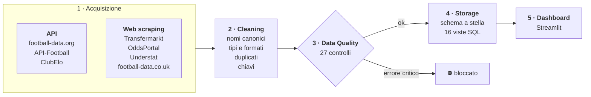

# Documentazione — Serie A Data Hub

Questa guida spiega come funziona il progetto: da dove arrivano i dati, come vengono puliti e controllati,
dove sono salvati e come leggere le analisi. Non serve leggerla tutta: scegli il punto di partenza qui sotto.

## Da dove iniziare

| Se sei… | Parti da | Poi |
|---|---|---|
| **curioso dei risultati** | [Guida alla dashboard](dashboard.md): cosa mostra ogni grafico e come leggerlo | [Glossario](glossario.md) per i termini tecnici |
| **interessato all'ingegneria dei dati** | [Pipeline dei dati](pipeline.md): acquisizione, cleaning, storage | [Data Quality](data-quality.md), [Modello dati](modello-dati.md) |
| **qualcuno che vuole usare o estendere il progetto** | [Avvio rapido](#avvio-rapido) qui sotto | [Configurazione e comandi](configurazione.md) |
| **qualcuno che vuole interrogare i dati in SQL** | [Modello dati](modello-dati.md): tabelle, viste ed esempi di query | [Configurazione](configurazione.md#aprire-il-database-con-un-client-sql) per collegare DBeaver |

## Tutti i documenti

| # | Documento | In una frase |
|---|---|---|
| 1 | **Panoramica** (questa pagina) | Cos'è il progetto, come avviarlo, com'è organizzato |
| 2 | [Pipeline dei dati](pipeline.md) | Come i dati passano dalle 7 fonti al database, step per step |
| 3 | [Modello dati](modello-dati.md) | Le tabelle del data warehouse e le 16 viste analitiche |
| 4 | [Data Quality](data-quality.md) | I 27 controlli che garantiscono che i dati siano corretti |
| 5 | [Guida alla dashboard](dashboard.md) | Le 8 pagine Streamlit: cosa mostrano e con quale metodo |
| 6 | [Configurazione e comandi](configurazione.md) | Token, stagioni, comandi, PostgreSQL, problemi frequenti |
| 7 | [Glossario](glossario.md) | I termini di calcio, scommesse e data engineering usati nel progetto |

---

## Panoramica

Serie A Data Hub raccoglie i dati delle **ultime 4 stagioni concluse** della Serie A
(a ottobre 2026: 2022/23, 2023/24, 2024/25, 2025/26) da sette fonti gratuite, li integra in un unico
database e li presenta in una dashboard.



| Step | Legge da | Scrive in |
|---|---|---|
| 1. Acquisizione | le fonti online | `data/raw/<fonte>/` |
| 2. Cleaning | `data/raw/` | `data/clean/` |
| 3. Data Quality | `data/clean/` | `data/reports/quality_report.md` |
| 4. Storage | `data/clean/` | `data/football.db` |
| 5. Dashboard | `data/football.db` | — |

Ogni step legge da disco l'output del precedente, quindi può essere eseguito da solo.
`python main.py run` li esegue tutti in sequenza e registra l'esecuzione nel database.

### Avvio rapido

**Requisiti:** Python 3.11 o superiore. Facoltativi: Google Chrome (o Firefox) per lo scraping di OddsPortal,
token gratuiti per football-data.org e API-Football (senza token le due API vengono saltate).

```bash
python -m venv .venv && source .venv/bin/activate
pip install -r requirements.txt

streamlit run app/Home.py   # dashboard su http://localhost:8501
```

Questo basta per vedere la dashboard: i dati grezzi sono già nel repository e il database viene costruito
al primo avvio. Per scaricare dati nuovi:

```bash
cp .env.example .env        # inserire i token (facoltativo)
python main.py run          # scarica ciò che manca, pulisce, controlla, carica
```

### Struttura del repository

```
main.py                      CLI unica della pipeline
config/settings.yaml         stagioni, fonti, priorità, database
config/team_aliases.yaml     nome canonico di ogni squadra e sue varianti
football_pipeline/
  acquisition/               step 1: una classe per fonte
  cleaning/                  step 2: parser, risoluzione nomi, modello a stella
  quality/                   step 3: controlli di qualità
  storage/                   step 4: schema, caricamento, viste SQL (storage/views/)
  analysis/                  metriche statistiche usate dalla dashboard
  pipeline.py                orchestratore
app/                         dashboard Streamlit (Home.py + pages/)
data/raw/                    dati grezzi (versionati)
data/clean/                  output del cleaning (rigenerato)
data/reports/                report di Data Quality (rigenerato)
data/football.db             data warehouse SQLite (rigenerato)
tests/                       test automatici (pytest)
legacy/                      notebook e query della prima versione
docs/                        questa documentazione
```

---

## Evoluzione del progetto

Il progetto è nato come una serie di 8 notebook Jupyter da eseguire a mano, con caricamento
su PostgreSQL. I notebook originali sono conservati in `legacy/`. La versione attuale lo ha riprogettato:

| Prima | Ora |
|---|---|
| 8 notebook eseguiti a mano in un ordine preciso | Una CLI (`python main.py run`) e step indipendenti |
| Stagioni scritte nel codice | Ultime 4 stagioni concluse, calcolate dalla data |
| 4 fonti (football-data.org, API-Football, Transfermarkt, OddsPortal) | 7 fonti: aggiunte football-data.co.uk, Understat e ClubElo; le fonti dei risultati si controllano a vicenda |
| Nomi squadra confrontati con quelli delle quote | Dizionario di alias + similarità testuale |
| Controlli di qualità come stampe a schermo | 27 controlli con severità, soglie, blocco e storico |
| Solo PostgreSQL | SQLite di default (zero configurazione), PostgreSQL supportato |
| Analisi come file SQL da eseguire a parte | 16 viste nel database, dashboard Streamlit e test automatici |

Durante la riprogettazione i controlli di qualità hanno fatto emergere alcuni errori nei dati e nelle query
originali, ora corretti:

- le quote 2024/25 contenevano 400 righe duplicate (780 invece di 380), quindi le analisi sulle quote
  contavano più volte le stesse partite;
- il campo `winner` aveva valori diversi a seconda della fonte (`HOME_TEAM` contro `HOME_WINNER`), e le
  query sui punti sbagliavano tutta la stagione 2024/25;
- lo spareggio salvezza Spezia–Verona 2022/23 era contato come partita di campionato;
- i valori di mercato mancanti (`-`) diventavano 0, falsando medie e crescite;
- in caso di errore di rete il retry HTTP poteva ripetersi all'infinito.
