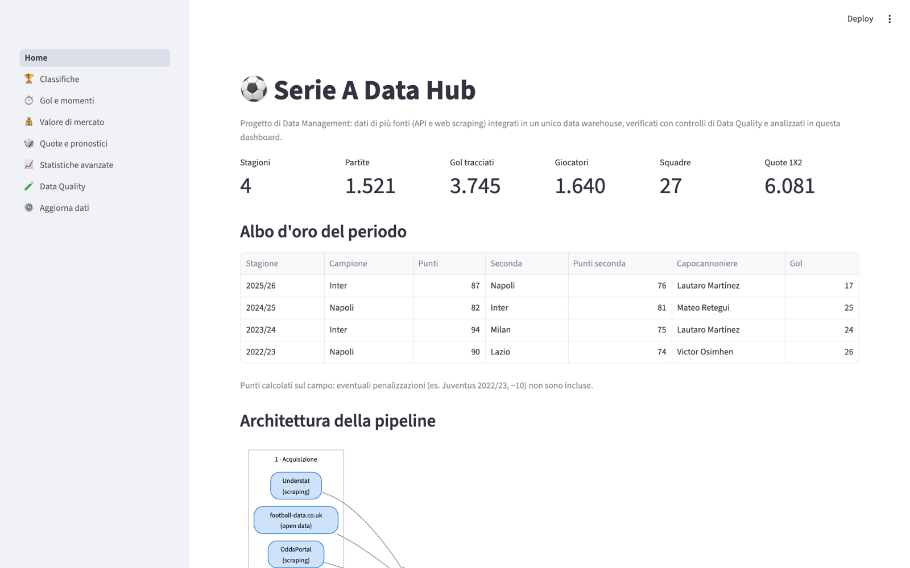
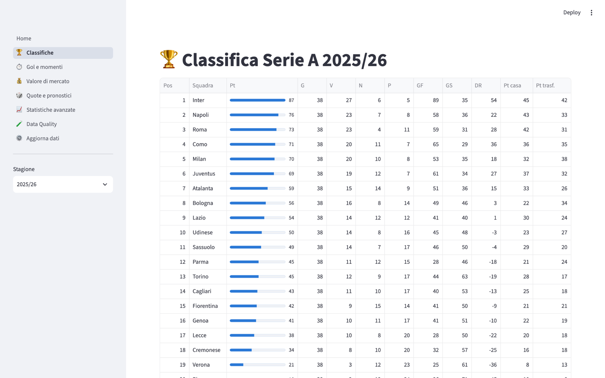
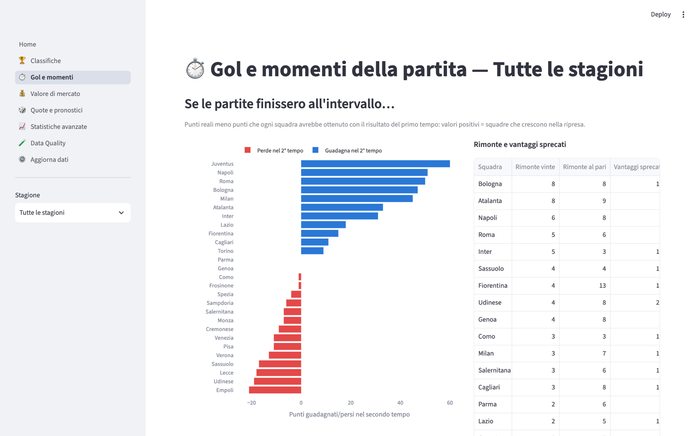
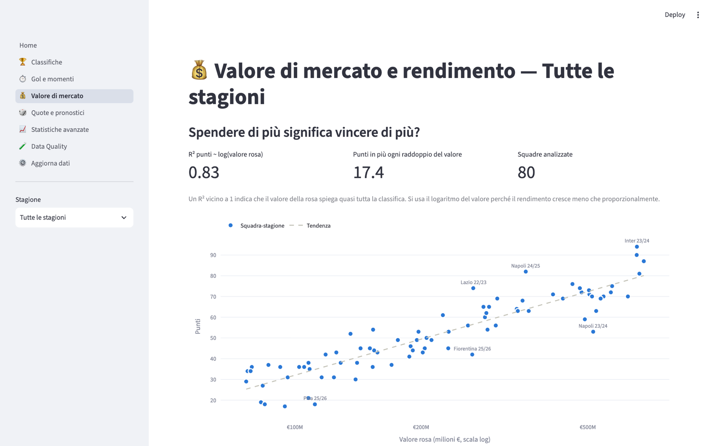
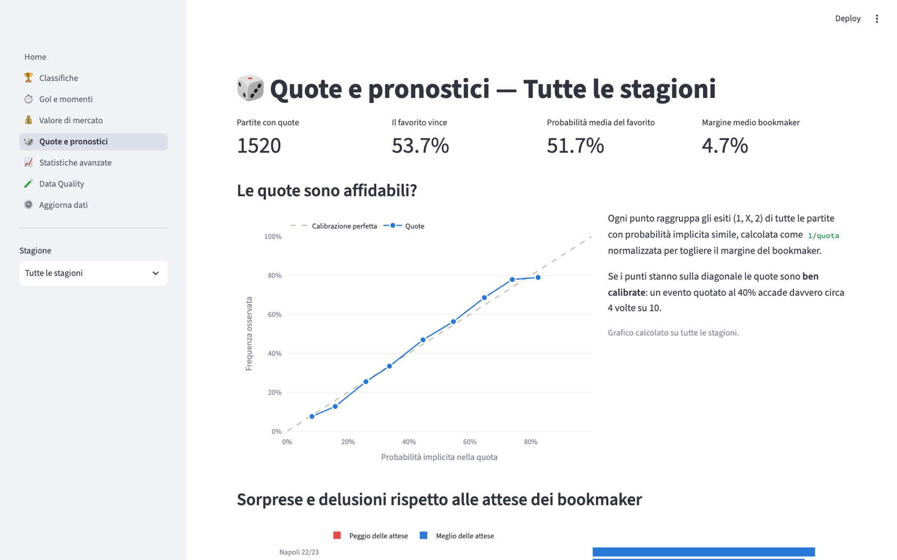
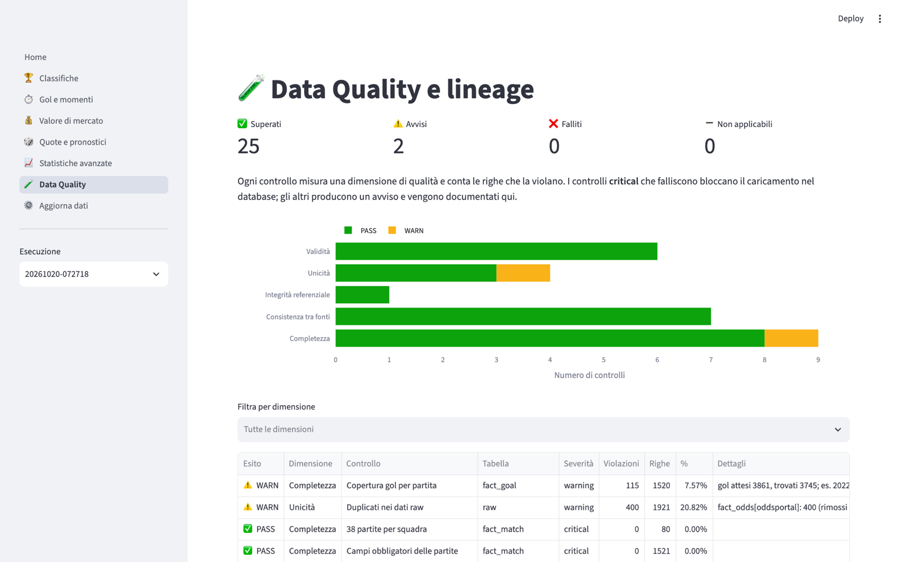

# 5. Guida alla dashboard

> **In breve.** La dashboard ha 8 pagine: 5 di analisi, una sulla qualità dei dati, una per aggiornarli e la
> Home. Per ogni grafico questa guida spiega **a quale domanda risponde**, **come leggerlo** e **come è
> calcolato**. I termini tecnici sono spiegati nel [glossario](glossario.md).

Avvio: `streamlit run app/Home.py` → http://localhost:8501.

La barra laterale contiene il menu delle pagine e, dove serve, il selettore della **stagione**
(in alcune pagine anche "Tutte le stagioni"). Tutti i grafici sono interattivi: passando il mouse
su barre, punti e linee si vedono i valori esatti; le tabelle si ordinano cliccando sull'intestazione.

Le pagine leggono le viste del database; i dati vengono messi in cache e si aggiornano dopo una nuova
esecuzione della pipeline (automaticamente se lanciata dalla pagina ⚙️ Aggiorna dati).

---

## 🏠 Home

- **Indicatori**: numero di stagioni, partite, gol tracciati, giocatori, squadre e quote nel database.
- **Albo d'oro**: per ogni stagione campione, seconda classificata e capocannoniere.
- **Architettura della pipeline**: schema delle fonti e degli step.
- **Fonti dati**: per ogni fonte, tipo e stato (✅ caricata / ➖ da acquisire).

## 🏆 Classifiche

- **Classifica** della stagione scelta, con punti fatti in casa e in trasferta.
- **Andamento dei punti**: punti cumulati partita dopo partita. Le squadre scelte nel campo
  "Squadre evidenziate" (default: le prime tre) sono colorate, le altre restano in grigio come contesto.
  Il tooltip indica avversario, campo ed esito di ogni partita.
- **Fattore campo**: % di vittorie in casa, pareggi e vittorie in trasferta per stagione; per ogni squadra
  la differenza tra punti fatti in casa e in trasferta (barre a destra = più forte in casa).

> I punti sono calcolati sul campo: le penalizzazioni (es. −10 alla Juventus nel 2022/23) non sono incluse.

## ⏱️ Gol e momenti

- **Se le partite finissero all'intervallo**: per ogni squadra, punti reali meno i punti che avrebbe
  ottenuto con il risultato del primo tempo. Valori positivi = squadre che migliorano nel secondo tempo.
  La tabella accanto conta rimonte vinte, rimonte concluse in pareggio e vantaggi sprecati.
- **Quando si segna**: gol per fascia di 15 minuti (31-45+ e 76-90+ comprendono il recupero).
- **Zona Cesarini**: saldo dei punti guadagnati e persi da ogni squadra con gol segnati o subiti dall'85'.
  *Metodo*: si confronta il risultato prima del primo gol all'85' o oltre con quello finale. Vengono usate
  solo le partite in cui i gol estratti coincidono con il risultato finale.
- **Classifica marcatori**: gol (autogol esclusi), ruolo, valore di mercato e valore per gol.

## 💰 Valore di mercato

- **Spendere di più significa vincere di più?** Grafico a dispersione tra valore della rosa (scala
  logaritmica) e punti, con retta di tendenza.
  *Metodo*: regressione lineare `punti = a + b · log10(valore)`. L'R² indica quanta parte delle differenze
  di punti è spiegata dal valore della rosa; "Punti in più ogni raddoppio del valore" = `b · log10(2)`.
- **Chi ha fatto meglio (o peggio) di quanto valeva la rosa**: punti reali meno punti previsti dalla
  regressione. Con "Tutte le stagioni" si vedono le 8 squadre-stagione migliori e le 8 peggiori.
- **Rivalutazione delle rose**: variazione % del valore tra la prima e l'ultima stagione in Serie A nel
  periodo (solo squadre con almeno due stagioni).
- **Giocatori: chi si è rivalutato di più**: filtri per ruolo, valore iniziale minimo e criterio di
  ordinamento (crescita in euro o in percentuale).
- **Curva età-valore per ruolo**: valore mediano per età e macro-ruolo (solo età con almeno 8 giocatori);
  sotto il grafico l'età di picco di ogni ruolo.

## 🎲 Quote e pronostici

Le quote sono trasformate in probabilità: `p = (1/quota) / Σ(1/quota)`. La divisione per la somma toglie
il margine del bookmaker, cioè la parte per cui la somma delle probabilità "grezze" supera il 100%.

- **Indicatori**: partite con quote, % di partite vinte dal favorito, probabilità media del favorito,
  margine medio del bookmaker.
- **Le quote sono affidabili?** (grafico di calibrazione) — spiegato in dettaglio
  [qui sotto](#come-funziona-il-grafico-di-calibrazione).
- **Sorprese e delusioni**: punti reali meno **punti attesi** dalle quote
  (`3 · P(vittoria) + 1 · P(pareggio)` sommato su tutte le partite).
- **Esiste una strategia che batte il bookmaker?** ROI di cinque strategie con puntata fissa di 1 € su ogni
  partita (sempre il favorito, la sfavorita, la squadra di casa, il pareggio, la squadra in trasferta).
- **Le sorprese più grandi**: le partite in cui l'esito finale aveva la quota più alta.

### Come funziona il grafico di calibrazione

**Domanda:** quando il bookmaker dice "questo evento ha il 40% di probabilità", succede davvero 4 volte su 10?

**1. Dalla quota alla probabilità.** Esempio reale, Inter–Lecce 2022/23:

| | 1 (casa) | X | 2 (trasferta) | Somma |
|---|---|---|---|---|
| Quota | 1,39 | 4,68 | 8,74 | |
| `1 / quota` | 0,719 | 0,214 | 0,114 | **1,047** |
| Probabilità normalizzata | **68,7%** | **20,4%** | **10,9%** | 100% |

La somma 1,047 supera 1 del 4,7%: è il **margine** del bookmaker. Dividendo ogni valore per la somma si
ottengono probabilità vere, che sommano al 100%.

**2. Ogni partita contiene tre previsioni.** "Inter vince" (68,7%, accaduto ✔), "pareggio" (20,4%, ✘),
"Lecce vince" (10,9%, ✘). Su 1.520 partite si ottengono 4.560 previsioni, ognuna con una probabilità e un
esito sì/no.

**3. Raggruppamento in fasce.** Le previsioni vengono divise in fasce di 10 punti (0–10%, 10–20%, …).
Per ogni fascia il grafico mostra un punto:
- **asse X**: probabilità media dichiarata dalle quote;
- **asse Y**: percentuale di previsioni che si sono avverate davvero.

Le fasce con meno di 10 previsioni vengono scartate perché troppo instabili.

**4. Come leggerlo.**
- punto **sulla diagonale** → quote corrette;
- punto **sopra** → l'evento accade più spesso di quanto dice la quota (il bookmaker lo sottostima);
- punto **sotto** → accade meno spesso (il bookmaker lo sopravvaluta).

**Cosa mostrano i dati.** Le quote sono molto ben calibrate: per esempio 33,6% previsto contro 33,4% osservato.
I favoriti netti (60–80%) vincono qualche punto più del previsto e gli sfavoriti (10–20%) un po' meno:
è il noto *favourite–longshot bias*. Lo scarto però è troppo piccolo per compensare il margine, e infatti
nessuna strategia della sezione «Esiste una strategia che batte il bookmaker?» ha ROI positivo.

Il grafico usa sempre tutte le stagioni: con una sola stagione le fasce estreme avrebbero troppo pochi eventi.

## 📈 Statistiche avanzate

Tre schede con le fonti aggiuntive. Se una fonte non è ancora stata acquisita, la scheda mostra il comando
per scaricarla.

- **Expected goals** (Understat): gol segnati contro xG prodotti (sopra la diagonale = finalizzazione
  migliore della qualità delle occasioni) e tabella con GF−xG e xGA−GS (parate/fortuna in difesa).
  La riga "Differenza xG vs punti" riporta l'R² tra differenza xG e punti in classifica.
- **Rating Elo** (ClubElo): Elo a inizio stagione contro punti finali e variazione dell'Elo nella stagione.
- **Tiri e disciplina** (football-data.co.uk): tiri contro gol, % di tiri in porta, % di conversione,
  corner, falli, cartellini; classifica degli arbitri con almeno 10 partite.

## 🧪 Data Quality

- Riepilogo dei controlli superati, avvisi, falliti e non applicabili, e grafico per dimensione.
- Tabella dei controlli (prima i falliti e gli avvisi) con violazioni, percentuale e dettagli; filtro
  per dimensione.
- **Log del cleaning**: righe modificate o scartate e fonte primaria scelta per ogni stagione.
- **Righe caricate per tabella** e **storico delle esecuzioni**.
- **Modello dati**: diagramma dello schema a stella.

Dal menu laterale "Esecuzione" si può consultare il report di un'esecuzione passata.

## ⚙️ Aggiorna dati

- **Stato delle fonti**: per ogni fonte e dataset, se è abilitata, se le credenziali sono presenti,
  quante stagioni sono già in cache e quali mancano.
- **Esegui**: scelta delle fonti, opzione per riscaricare anche le stagioni in cache, opzione per caricare
  anche con errori critici, oppure solo cleaning + quality + storage senza richieste di rete.
  Al termine compaiono l'esito di ogni richiesta e il log completo, e le altre pagine mostrano i nuovi dati.

Lo scraping completo di una stagione richiede qualche minuto (Transfermarkt ~2 min, OddsPortal ~1 min).
